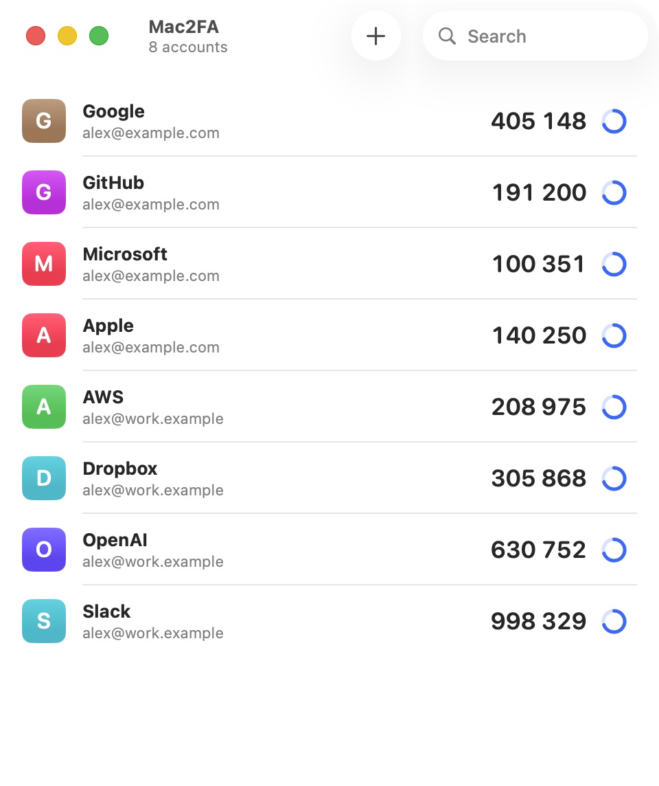
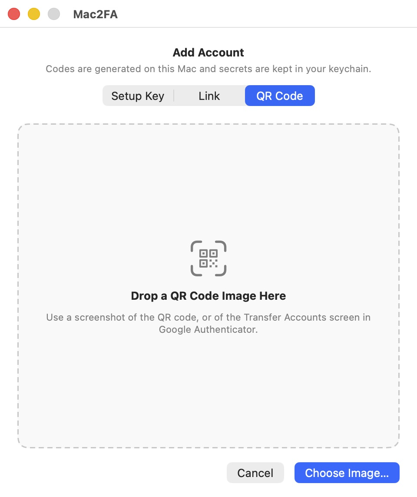
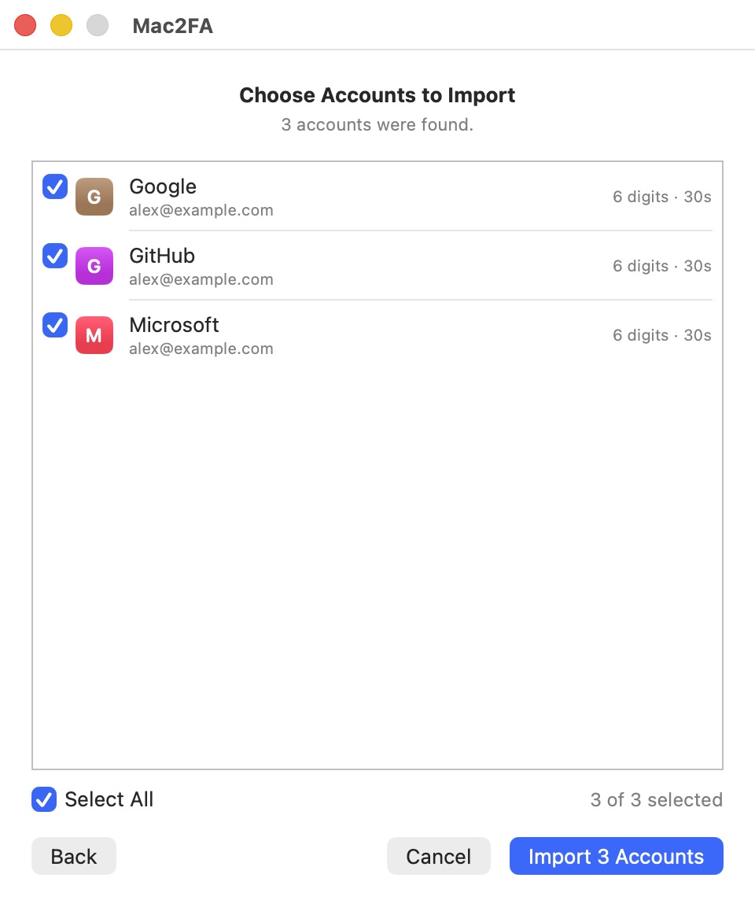
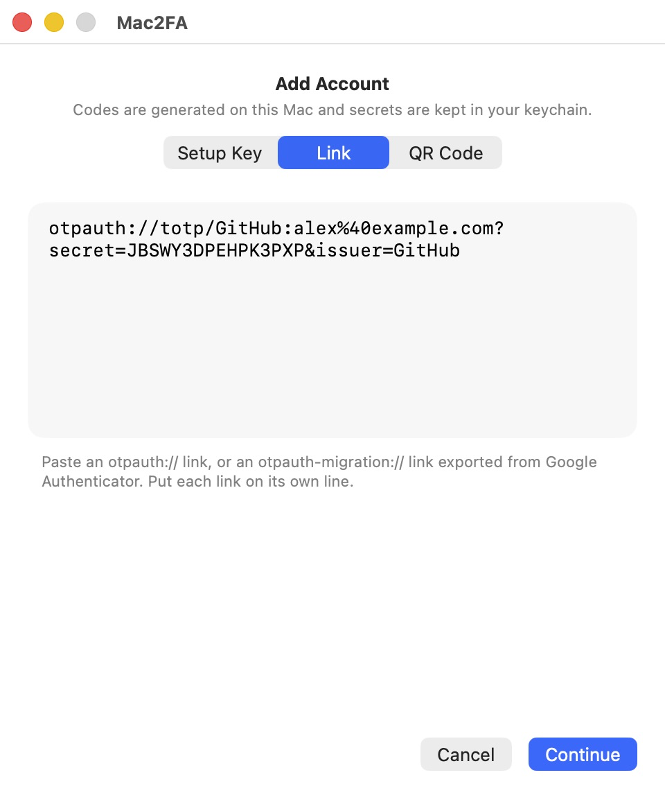
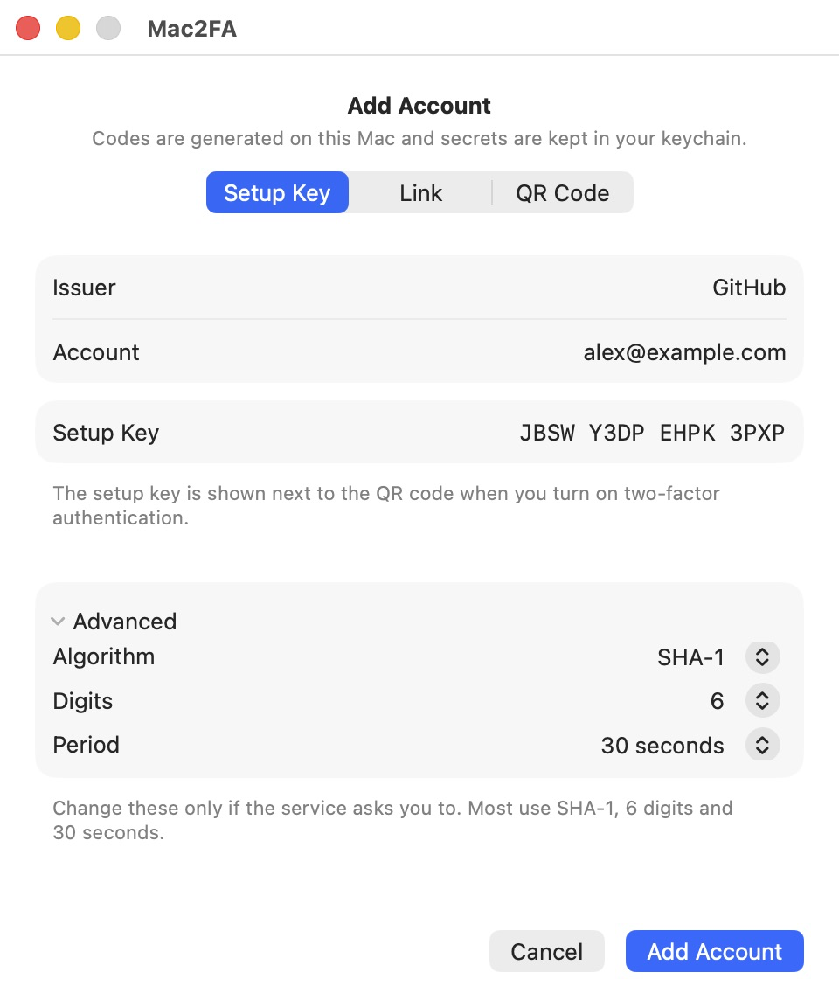

<p align="center">
  
</p>

# Mac2FA

Mac2FA works locally-offline with your Google Authenticator and with other apps by generating the same TOTP code. 
It is a lightweight macOS two-factor authentication app for generating TOTP codes locally. It supports Google Authenticator imports, standard `otpauth://` TOTP accounts, and local secret storage through the macOS Keychain.

## Screenshots

The current interface, shown with demo accounts and setup keys.

<p>
  
</p>

<p>
  
  
</p>

<p>
  
  
</p>

## Features

- Generate TOTP codes for saved accounts, with a countdown ring that turns red in the last five seconds.
- Copy a code by clicking it, double-clicking its row, or selecting the row and pressing Return or ⌘C. Copied codes are cleared from the clipboard after 30 seconds.
- Search accounts by issuer or account label.
- Add accounts with a Base32 setup key, with live validation.
- Import standard `otpauth://` TOTP links by pasting them, one per line.
- Import Google Authenticator migration links and QR codes, and choose which accounts to import.
- Import OTP QR codes from image files or drag-and-drop.
- Delete accounts from the context menu or with the Delete key.
- Check GitHub releases for app updates and download the latest DMG directly. Open the DMG and drag Mac2FA to Applications to replace the installed version.

## Keyboard Shortcuts

| Action | Shortcut |
| --- | --- |
| Add an account | ⌘N |
| Copy the selected code | ⌘C or Return |
| Delete the selected account | Delete |

## Design

The interface follows the macOS Human Interface Guidelines: a single window with a native list and toolbar search, standard sheets with Cancel and default buttons, inline validation, system colors that adapt to light and dark mode, and VoiceOver labels for codes and countdowns.

The app icon follows the macOS icon grid (an 824 × 824 pt continuous-corner shape on a 1024 × 1024 canvas). Its countdown ring is the same one shown next to each code. The vector source is in `docs/icon/AppIcon.svg`.

## Requirements

- Supports Intel (`x86_64`) and Apple silicon (`arm64`) Macs with a single universal app.
- macOS 14.0 or later
- Xcode with Swift 6 support
- XcodeGen, only if you want to regenerate `Mac2FA.xcodeproj` from `project.yml`

## Project Structure

- `Mac2FA/App`: app entry point
- `Mac2FA/UI`: SwiftUI screens and account list rows
- `Mac2FA/OTP`: Base32, HOTP, TOTP, OTP Auth URI, and Google migration parsing
- `Mac2FA/Storage`: account persistence and Keychain integration
- `Mac2FA/Update`: GitHub release update checking
- `Mac2FATests`: unit tests for OTP parsing and generation helpers
- `project.yml`: XcodeGen project definition

## Build and Run

Open the existing Xcode project:

```sh
open Mac2FA.xcodeproj
```

Then select the `Mac2FA` scheme and run the app.

If you change `project.yml`, regenerate the Xcode project with XcodeGen:

```sh
xcodegen generate
```

## Testing

Run the unit test target from Xcode, or use:

```sh
xcodebuild test -project Mac2FA.xcodeproj -scheme Mac2FA -destination 'platform=macOS'
```

The current test suite covers Base32 decoding, TOTP generation, `otpauth://` parsing, and Google Authenticator migration parsing.

## Data Storage

Mac2FA stores account metadata in:

```text
~/Library/Application Support/Mac2FA/accounts.json
```

OTP secrets are stored separately in the macOS Keychain under the `Mac2FA` service name. Deleting an account removes both its metadata and its associated Keychain secret.

## Authenticator Compatibility

Mac2FA supports importing accounts from:

- Google Authenticator migration QR codes and `otpauth-migration://` links
- Standard `otpauth://totp/...` QR codes and links used by many 2FA providers
- Manual TOTP setup keys in Base32 format

Mac2FA does not currently support proprietary exports from other authenticator apps unless they expose standard `otpauth://` TOTP data.

## Supported OTP Types

The app currently accepts only TOTP accounts for storage and code generation. HOTP entries can be parsed from imported data, but they are shown as unsupported and are not imported.

Supported TOTP settings:

- Algorithms: SHA-1, SHA-256, SHA-512
- Digits: 6, 7, or 8
- Periods: any positive period when imported, with 30 and 60 seconds available in manual entry
